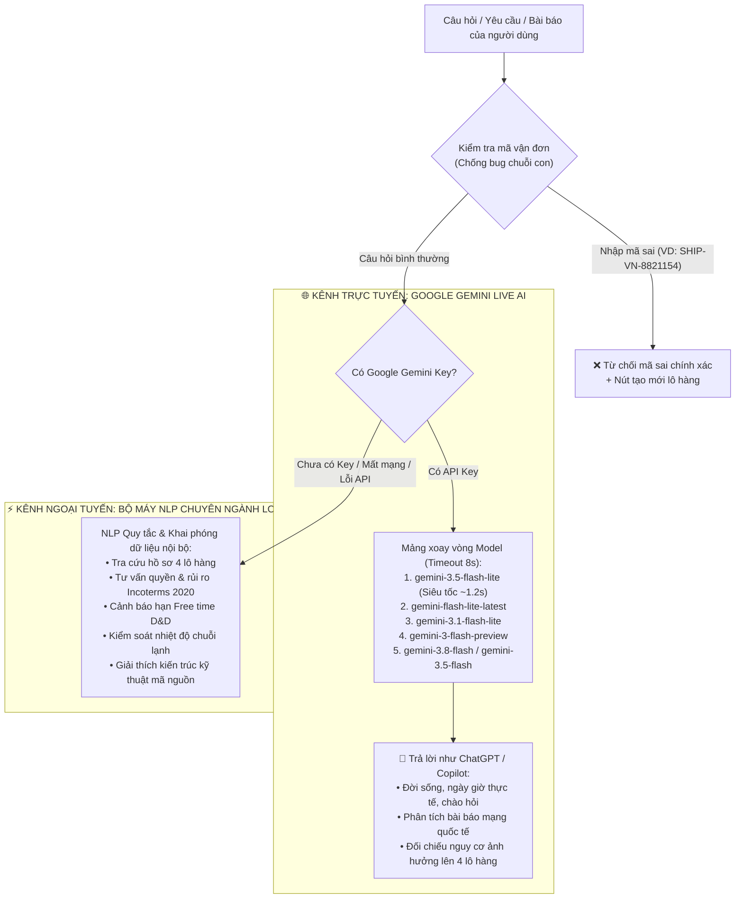

# CẨM NANG HƯỚNG DẪN DEMO & TÀI LIỆU TOÀN DIỆN DỰ ÁN OMNIFLOW 360 PRO
### *Hệ Thống Trung Tâm Điều Hành Vận Tải Đa Phương Thức Thông Minh (VN Logistics OS v5.0)*

---

## 📌 THÔNG TIN TỔNG QUAN
- **Tên hệ thống:** OmniFlow 360 Pro — Multimodal Logistics Control Tower
- **Tệp nguồn chính:** [`omniflow_multitrack_pro.html`](file:///e:/Desktop/VTDPT/omniflow_multitrack_pro.html) (File duy nhất chạy độc lập Client-side Standalone, không phụ thuộc máy chủ backend).
- **Môi trường hoạt động:** Trình duyệt Google Chrome, Microsoft Edge, Brave, Cốc Cốc (khuyến nghị màn hình Full HD 1920x1080 trở lên).
- **Cơ sở dữ liệu nội bộ:** `IndexedDB` (database: `omniflow-demo-v3`, object store: `kv`), tự động fallback sang `localStorage`.
- **Hệ thống AI:** Động cơ AI Kép (Hybrid Dual-Engine AI) kết hợp **Google Gemini Live API v1beta** (mảng model luân phiên siêu tốc) và **Bộ máy NLP chuyên sâu Logistics ngoại tuyến (Offline)**.

---

## 🌟 MỤC LỤC CẨM NANG
1. [Giới thiệu Dự án & Mục tiêu Cốt lõi](#1-giới-thiệu-dự-án--mục-tiêu-cốt-lõi)
2. [Kiến trúc Kỹ thuật & Công nghệ Đột phá](#2-kiến-trúc-kỹ-thuật--công-nghệ-đột-phá)
3. [Danh mục 4 Hồ sơ Lô hàng Đa phương thức Mẫu](#3-danh-mục-4-hồ-sơ-lô-hàng-đa-phương-thức-mẫu)
4. [Hướng dẫn Chi tiết 6 Phân hệ Nghiệp vụ (Tab-by-Tab)](#4-hướng-dẫn-chi-tiết-6-phân-hệ-nghiệp-vụ)
   - [Tab 1: Control Tower Realtime (Bản đồ & Điều hành thời gian thực)](#tab-1-control-tower-realtime)
   - [Tab 2: Shipment & Timeline (Quản lý Lô hàng, Chặng & Chuỗi lạnh)](#tab-2-shipment--timeline)
   - [Tab 3: Vận đơn & Hải quan (Kho chứng từ số B/L, AWB, Tờ khai Excel)](#tab-3-vận-đơn--hải-quan)
   - [Tab 4: Phân tích ETA (Mô hình toán học 3 Kịch bản khủng hoảng)](#tab-4-phân-tích-eta)
   - [Tab 5: Trung tâm thông báo (Quy trình chỉ huy xử lý Sự cố & Email)](#tab-5-trung-tâm-thông-báo)
   - [Tab 6: Trợ lý tra cứu (Hybrid AI Chatbot: ChatGPT + Copilot + Logistics)](#tab-6-trợ-lý-tra-cứu)
5. [Kịch bản Thuyết trình / Demo Từng Bước (Demo Script Chuẩn)](#5-kịch-bản-thuyết-trình--demo-chuẩn)
6. [Bộ câu hỏi Kiểm thử "Sát hạch" Trợ lý AI (Cheat Sheet)](#6-bộ-câu-hỏi-kiểm-thử-trợ-lý-ai-cheat-sheet)
7. [Kiểm thử Kỹ thuật Tự động (Automated Test Suites)](#7-kiểm-thử-kỹ-thuật-tự-động)

---

## 1. GIỚI THIỆU DỰ ÁN & MỤC TIÊU CỐT LÕI

**OmniFlow 360 Pro** là hệ thống Tháp điều hành Logistics (Logistics Control Tower) thế hệ mới, giải quyết bài toán phức tạp bậc nhất của ngành giao nhận: **Giám sát và ra quyết định thời gian thực cho các chuỗi cung ứng vận tải đa phương thức xuyên biên giới**.

### Hệ thống tích hợp toàn diện 5 phương thức vận chuyển:
1. 🚛 **Đường bộ (Road):** Vận chuyển sơ cấp và chặng cuối (First/Last Mile) kết nối nhà máy, cảng biển, ga đường sắt và sân bay.
2. 🚢 **Đường biển (Ocean/Sea):** Vận tải container xuyên đại dương qua các tuyến hàng hải huyết mạch (Châu Âu – Vịnh Suez – Châu Á, Đông Á – Đông Nam Á).
3. 🚆 **Đường sắt liên vận (Rail):** Tuyến liên vận Á – Âu và Trung – Việt qua cửa khẩu quốc tế Bằng Tường / Ga Đồng Đăng.
4. ✈️ **Hàng không (Air):** Vận chuyển cấp tốc các mặt hàng nhạy cảm nhiệt độ (chuỗi lạnh thủy sản đông lạnh) bay qua các trạm trung chuyển Taipei (TPE), Anchorage (ANC), New York (JFK).
5. 🛳️ **Thủy nội địa (Inland Waterway):** Vận chuyển sà lan gom hàng từ cụm cảng sông về cụm cảng nước sâu quốc tế.


---

## 2. KIẾN TRÚC KỸ THUẬT & CÔNG NGHỆ ĐỘT PHÁ

Dự án được đóng gói trọn vẹn trong **01 tệp HTML duy nhất** nhưng sở hữu nền tảng kiến trúc phần mềm chuẩn công nghiệp:

### 2.1. Động cơ Bản đồ & Định tuyến Thông minh (Routing Engine)
- **Leaflet.js Dark Mode:** Bản đồ vệ tinh hiển thị mượt mà trên nền CartoDB Dark Matter tiles.
- **Đường bộ:** Tích hợp trực tiếp API **OSRM** (`router.project-osrm.org`) tính toán cự ly thực tế và thời gian lái xe theo mạng lưới đường sá OpenStreetMap.
- **Đường biển:** Sử dụng module ESM `searoute-ts` trên mạng lưới hàng hải quốc tế **MARNET 20km**. Tích hợp mảng tọa độ tiếp cận luồng hàng hải vào cảng (`portApproach`), bộ lọc khử gai nhọn (`despur`) và thuật toán làm mịn đường cong **Chaikin 2 vòng lặp** (đảm bảo tàu di chuyển uốn lượn chính xác qua eo biển Malacca, Bab-el-Mandeb, kênh Suez mà không bao giờ bị lỗi chạy xuyên lục địa).
- **Đường sắt:** Tích hợp **OpenRailRouting** bám sát tim đường ray OSM thật, có dự phòng danh mục tọa độ ga chính Bắc – Nam (`RAIL_VN`).
- **Hàng không:** Giải thuật **Great-Circle (Đường vòng tròn lớn)** chia 96 điểm trên mặt cầu Ellipsoid, tích hợp hàm `unwrapGeometry` xử lý mượt mà khi máy bay bay cắt ngang qua kinh tuyến 180° (Thái Bình Dương).
- **Cơ chế đệm (Cache):** Toàn bộ kết quả định tuyến đều được tự động lưu vào `localStorage` (khóa `omniflow_goc_map_routes_v1`) để tải lại trang là hiển thị tức thì.

### 2.2. Động cơ Mô phỏng Thời gian thực (Simulation Engine)
- Vòng lặp mô phỏng chạy qua `requestAnimationFrame` đảm bảo tốc độ khung hình 60 FPS mượt mà.
- **Hàm `locatePath(geo, t)`:** Sử dụng thuật toán **Tìm kiếm nhị phân (Binary Search)** trên mảng khoảng cách tích lũy được lưu trong bộ nhớ tạm qua `WeakMap` để nội suy vị trí phương tiện chính xác tới từng centimet.
- **Phát hiện va chạm sự cố (Collision Detection):** Khi phương tiện di chuyển chạm điểm xảy ra sự cố trên tuyến, hệ thống tự động tạm dừng mô phỏng 3 giây và bung popup cảnh báo nguy cấp.
- **Camera thông minh:** Tự động bắt khung hình bao phủ (`fitVisibleRoutes` và `legCamera`) mỗi khi đổi chặng hoặc chuyển lô hàng.

### 2.3. Lưu trữ Độc lập Client-side (Zero-backend Persistence)
- Sử dụng **IndexedDB** (`omniflow-demo-v3`), lưu trữ trạng thái lô hàng, danh sách sự cố và phương án ETA tại khóa `state`.
- **Chứng từ số Base64:** Hình ảnh vận đơn B/L và tệp bảng tính hải quan Excel được chuyển đổi sang chuỗi Base64 và nhúng trực tiếp trong file mã nguồn tại khóa `asset-{id}` (hỗ trợ tệp đính kèm lên tới 8 MB).
- **Thuật toán nhận diện FNV-1a 32-bit:** Băm dữ liệu nhị phân của ảnh để đối chiếu fingerprint, cho phép hệ thống tự động nhận diện ảnh vận đơn mẫu và tự điền biểu mẫu trong tích tắc.

### 2.4. Động cơ AI Kép (Hybrid Dual-Engine AI Architecture)


---

## 3. DANH MỤC 4 HỒ SƠ LÔ HÀNG ĐA PHƯƠNG THỨC MẪU

Dữ liệu được chuẩn hóa theo đúng tiêu chuẩn vận tải thương mại quốc tế:

| Thuộc tính | Lô 1: `SHIP-VN-8821` | Lô 2: `SHIP-VN-9042` | Lô 3: `SHIP-VN-7710` | Lô 4: `SHIP-VN-3391` |
|---|---|---|---|---|
| **Tên hàng hóa** | Cụm phanh ABS ô tô | Cụm màn hình điện thoại OLED | Tôm sú đông lạnh size 16/20 | Phân bón Amoni Sunfat (NH4)2SO4 |
| **Mã số HS** | `8708.30.29` | `8524.91.00` | `0306.17.90` | `3102.21.00` |
| **Người gửi (Shipper)** | Robert Bosch GmbH (Đức) | Lens Technology (Trung Quốc) | CP XNK Thủy sản Miền Trung | Sinochem Holdings (TQ) |
| **Người nhận (Consignee)**| VinFast Trading & Production | Samsung Electronics Thái Nguyên | Eastern Fish Company (USA) | Hóa chất Agrilas Việt Nam |
| **Phương thức** | 🚛 Bộ $\to$ 🚢 Biển $\to$ 🚛 Bộ | 🚛 Bộ $\to$ 🚆 Sắt $\to$ 🚛 Bộ | 🚛 Bộ $\to$ ✈️ Hàng không $\to$ 🚛 Bộ | 🛳️ Thủy $\to$ 🚢 Biển $\to$ 🚛 Bộ |
| **Hành trình** | Stuttgart $\to$ Hamburg $\to$ Hải Phòng $\to$ Cát Hải | Trường Sa $\to$ Bằng Tường $\to$ Đồng Đăng $\to$ SEVT | Đà Nẵng $\to$ TPE $\to$ ANC $\to$ JFK $\to$ Teaneck | Dương Châu $\to$ Thượng Hải $\to$ Cát Lái $\to$ Tây Ninh |
| **Phương tiện** | Tàu biển MOL Truth | Đoàn tàu liên vận 2502 | Chuyên cơ FedEx B777F | Tàu biển OOCL Vietnam |
| **Số Vận đơn** | B/L: `MAEU2204567` | B/L: `CR2026-8899` | AWB: `023-44556606` | B/L: `OOLU7788990` |
| **Số Container / ULD** | `MRKU9876543` (40HC) | `TGHU1122334` (40HC) | Mâm `PMC98765FX` $\to$ 20RF | `OOLU5566778` (20GP) |
| **Khối lượng VGM** | 24.5 tấn | 18.2 tấn | 12.8 tấn | 27.0 tấn |
| **Điều kiện Incoterms** | **CIF Hải Phòng** | **EXW Trường Sa** | **CPT New York** | **FOB Thượng Hải** |
| **Phân luồng Hải quan** | 🟡 **Luồng Vàng** (`104567890123`) | 🟢 **Luồng Xanh** (`104567890124`) | 🟢 **Luồng Xanh** (`104567890125`) | 🔴 **LUỒNG ĐỎ** (`104567890126`) |
| **Kiểm soát nhiệt độ** | Không yêu cầu | Không yêu cầu | **-18°C $\pm$ 2°C (Cold-chain)** | Không yêu cầu |
| **Thời hạn D&D** | 10 ngày còn lại (33%) | 14 ngày còn lại (0%) | 12 ngày còn lại (20%) | ⚠️ **Chỉ còn 2 ngày (80%)** |
| **Sự cố / Kịch bản** | Nguy cơ nghẽn Kênh Suez | Lệch cân VGM tại ga biên giới | Nguy cơ mất điện lạnh sau JFK | Bị giữ kiểm hóa luồng đỏ |

---

## 4. HƯỚNG DẪN CHI TIẾT 6 PHÂN HỆ NGHIỆP VỤ

### Tab 1: Control Tower Realtime
Giao diện trung tâm giám sát bản đồ vệ tinh toàn cầu:
- **5 Thẻ KPI thời gian thực:**
  - *Tổng lô hàng:* Hiển thị số lượng lô đang theo dõi.
  - *Tỷ lệ luồng xanh:* Tỷ lệ % lô hàng được thông quan luồng xanh VNACCS.
  - *ETA đúng kế hoạch:* Thống kê số lô On-track vs Delay.
  - *Cảnh báo ngoại lệ:* Số lượng báo cáo sự cố chưa được giải quyết.
  - *Vận đơn điện tử:* Số lượng hồ sơ có đầy đủ chứng từ số.
  *(Nhấp chuột vào từng thẻ KPI sẽ tự động chuyển hướng nhanh sang Tab chức năng tương ứng).*
- **Bộ lọc tuyến đường (`route-filter`):** Cho phép xem toàn bộ 4 tuyến cùng lúc hoặc phóng to riêng từng tuyến (`SHIP-VN-8821`, `9042`, `7710`, `3391`).
- **Nút "Chạy mô phỏng / Tạm dừng":** Kích hoạt chuyển động phương tiện trên toàn hành trình. Khi gặp mốc sự cố, phương tiện tự động phanh dừng 3 giây và mở popup chi tiết sự cố.
- **Bảng Active Fleet Tracking:** Hiển thị vị trí mốc hiện tại, tiến độ % chặng và bộ lọc trạng thái (ALL / TRANSIT / DELAY / HOLD / CLEAR).

---

### Tab 2: Shipment & Timeline
Phân hệ quản lý chi tiết từng hồ sơ vận chuyển:
- **Thanh tiến trình Stepper đa mốc:** Trực quan hóa từng chặng đường (Đã hoàn thành $\to$ Đang thực hiện $\to$ Chờ xử lý).
- **Đồng hồ hạn lưu bãi D&D (Demurrage & Detention Free Time):** Hiển thị thanh tiến trình trực quan cảnh báo nguy cơ quá hạn phạt tiền lưu container tại cảng (Đặc biệt với lô `SHIP-VN-3391` ở mức báo động 80%).
- **Kiểm soát chuỗi lạnh (Lô 7710):** Theo dõi mức nhiệt độ hồ sơ -18°C, cảnh báo máy lạnh Reefer Alert và lịch sử kiểm tra nhiệt độ tại các trạm trung chuyển (Đà Nẵng, TPE, ANC, JFK).
- **Chức năng "+ Thêm lô hàng":**
  1. Nhập thông tin chủ hàng, người nhận, tên hàng, mã HS, Incoterms.
  2. Bấm thêm từng chặng nối tiếp, có thể nhấp trực tiếp lên bản đồ để lấy tọa độ Lat/Lng.
  3. Kéo thả tệp ảnh vận đơn (PNG/JPG) và tệp tờ khai hải quan (XLS/XLSX) tối đa 8 MB.
  4. Bấm **Tạo bản nháp** $\to$ Kiểm tra lại thông tin $\to$ Bấm **Xác nhận lưu hồ sơ**.
- **Mô phỏng nhận diện vận đơn tự động:** Khi tải lên ảnh mẫu có sẵn trong thư viện, hệ thống băm mã FNV-1a và tự động điền sẵn các trường thông tin tương ứng.

---

### Tab 3: Vận đơn & Hải quan
Trung tâm số hóa chứng từ thương mại & pháp lý:
- **Xem chứng từ điện tử gốc nhúng sẵn:**
  - Lô `SHIP-VN-8821`: Đủ ảnh B/L Maersk Lines & Tệp tờ khai hải quan Excel.
  - Lô `SHIP-VN-7710`: Đủ ảnh AWB FedEx Express & Tệp tờ khai hải quan Excel.
  - Lô `SHIP-VN-3391`: Đủ ảnh B/L OOCL & Tệp tờ khai hải quan Excel.
  - Lô `SHIP-VN-9042`: Có ảnh B/L China Railway & Nút cho phép bổ sung tờ khai hải quan.
- **Tải file Excel nguyên bản:** Bấm nút **Tải tệp Excel** để tải trực tiếp tờ khai hải quan VNACCS chuẩn về máy tính mà không cần qua server.
- **Tra cứu tờ khai hải quan điện tử:** Ô tìm kiếm tờ khai theo số `104567890123`, `104567890124`...
- **Xem Lệnh giao hàng điện tử (e-DO):** Nhấp nút **Xem e-DO** tại lô hàng để mở modal xem trước lệnh giao hàng điện tử gửi cảng.

---

### Tab 4: Phân tích ETA
Động cơ tính toán toán học hỗ trợ người điều hành ra quyết định khi xảy ra sự cố chuỗi cung ứng:
- **3 Kịch bản khủng hoảng tích hợp sẵn:**
  1. **Lô `SHIP-VN-7710` (Chuỗi lạnh thủy sản):** Sự cố mất điện kho lạnh sân bay JFK $\to$ Lập phương án điều phối chuyển sang Kho lạnh dự phòng A $\to$ Tính chi phí chạy xe bảo quản phát sinh và thời gian trễ.
  2. **Lô `SHIP-VN-8821` (Đường biển châu Âu):** Giả định tắc nghẽn eo biển Bab-el-Mandeb / Kênh Suez $\to$ Tính toán chuyển hướng hải trình đi vòng qua Mũi Hảo Vọng (Cape of Good Hope) $\to$ Tự động tính chênh lệch quãng đường (+3,500 hải lý), số giờ trễ (+186h) và chi phí phát sinh nhiên liệu (USD/km).
  3. **Lô `SHIP-VN-9042` (Đường sắt liên vận):** Sự cố phát hiện sai lệch phiếu cân VGM tại ga Bằng Tường/Đồng Đăng $\to$ Giữ kiểm tra lại 24 giờ $\to$ Tổng độ trễ 42 giờ.
- **Quy trình 2 bước an toàn:**
  - Bước 1: Bấm **Phân tích phương án** $\to$ Hệ thống vẽ tuyến đường cũ vs tuyến mới so sánh song song trên bản đồ mini, xuất bảng chi phí phát sinh mẫu.
  - Bước 2: Bấm **Chấp nhận phương án đề xuất** $\to$ ETA mới và tuyến đường mới lập tức được áp dụng vào toàn hệ thống (Dashboard, Bảng lô hàng, Stepper), đồng thời ghi vết lịch sử và khóa chống áp dụng trùng.

---

### Tab 5: Trung tâm thông báo
Quy trình chỉ huy và ứng phó sự cố (Incident Command Center):
- **Vòng đời 4 bước của sự cố:**
  $$\text{Mới báo} \longrightarrow \text{Đã xác nhận} \longrightarrow \text{Đang xử lý} \longrightarrow \text{Đã giải quyết}$$
- **Tạo báo cáo sự cố:**
  - Nhập họ tên người báo, chọn vai trò (*Tài xế / Nhân viên điều phối / Đại lý hãng tàu*).
  - Chọn lô hàng và chặng xảy ra sự cố.
  - Có thể nhấp chuột trên bản đồ để ghim tọa độ sự cố chính xác.
- **Liên kết bản đồ thông minh:** Khi sự cố được duyệt sang trạng thái *Đã xác nhận*, mốc sự cố màu đỏ sẽ tự động xuất hiện trên bản đồ Tab 1 để phục vụ mô phỏng va chạm dừng xe.
- **Trình xem trước email thông báo:** Tự động soạn thảo bản thảo email gửi Shipper và Consignee để thông báo tiến độ xử lý mà không cần gõ tay.

---

### Tab 6: Trợ lý tra cứu
Đột phá công nghệ với **Hệ thống AI Kép (Hybrid AI)**:
- **Thanh cấu hình Google Gemini Live AI:**
  - Tích hợp ô nhập API Key kèm nút ẩn/hiện mắt (`👁️`). Key được tự động ghi nhớ vào `localStorage`.
  - Huy hiệu trạng thái: `🟢 Gemini Live Active (gemini-3.5-flash-lite)`.
- **Mảng Model luân phiên siêu tốc (Fail-safe Rotation):**
  - Danh sách model: `gemini-3.5-flash-lite` (ưu tiên 1, phản hồi trong ~1.2s) $\to$ `gemini-flash-lite-latest` $\to$ `gemini-3.1-flash-lite` $\to$ `gemini-3-flash-preview` $\to$ `gemini-3.8-flash` $\to$ `gemini-3.5-flash`.
  - Tự động luân chuyển model nếu gặp lỗi hoặc quá tải (Timeout rút gọn 8 giây/model).
- **Thanh 9 Quick Chips 1 chạm:**
  `[📊 Tổng quan hôm nay]` `[⚠️ Lô nào đang trễ?]` `[🦐 Lô tôm đông lạnh 7710]` `[🚗 Lô hàng VinFast]` `[⚖️ Incoterms lô 8821]` `[🔴 Lô Luồng Đỏ]` `[📰 Phân tích tin Biển Đỏ]` `[🛰️ Thuật toán định tuyến]` `[💾 Kiến trúc lưu trữ]`
- **Chống lỗi chuỗi con tuyệt đối:** Nhập sai mã (như `SHIP-VN-8821154`) sẽ bị từ chối rõ ràng kèm nút mở form tạo mới, không bị nhận diện nhầm vào `SHIP-VN-8821`.
- **Chế độ Offline thông minh:** Khi chưa có API Key hoặc không có mạng, bộ máy NLP chuyên ngành vẫn trả lời trôi chảy mọi câu hỏi về 4 lô hàng, Incoterms, D&D, chuỗi lạnh, kiến trúc hệ thống và thời gian hiện tại.

---

## 5. KỊCH BẢN THUYẾT TRÌNH / DEMO CHUẨN

Dưới đây là kịch bản chuẩn từng phút dành cho buổi báo cáo hoặc trình diễn trước hội đồng / khách hàng:

### ⏱️ Phút 1: Mở màn & Tháp Điều hành Realtime (Tab 1)
1. Mở file `omniflow_multitrack_pro.html` trên trình duyệt.
2. Giới thiệu tổng quan: *"Đây là Hệ thống Tháp Điều hành Vận tải Đa phương thức OmniFlow 360 Pro, hoạt động độc lập không cần máy chủ backend."*
3. Chỉ vào **5 thẻ KPI**: Bấm vào thẻ *Tỷ lệ luồng xanh* hoặc *Cảnh báo ngoại lệ* để trình diễn tính năng nhảy Tab tức thì.
4. Chọn bộ lọc `route-filter` về lô `SHIP-VN-8821`, bấm nút **Chạy mô phỏng**: Cho người xem thấy tàu di chuyển uốn lượn mượt mà từ Đức qua eo biển Gibraltar, kênh Suez về Việt Nam.

### ⏱️ Phút 2: Khám phá Hồ sơ Lô hàng & Chuỗi lạnh (Tab 2)
1. Chuyển sang Tab 2, cuộn qua 4 lô hàng.
2. Dừng lại ở **lô `SHIP-VN-7710` (Tôm đông lạnh)**: Chỉ vào chỉ số kiểm soát nhiệt độ `-18°C`, mâm ULD hàng không chuyển sang container 20RF sau JFK.
3. Dừng lại ở **lô `SHIP-VN-3391` (Phân bón Agrilas)**: Nhấn mạnh cảnh báo D&D (Free time chỉ còn 2 ngày / 80%).
4. Bấm nút **+ Thêm lô hàng**: Mở modal, trình diễn giao diện tạo chặng đa phương thức chuyên nghiệp.

### ⏱️ Phút 3: Số hóa Vận đơn B/L & Hải quan VNACCS (Tab 3)
1. Chuyển sang Tab 3.
2. Bấm vào lô `SHIP-VN-8821`: Mở xem ảnh gốc **Vận đơn đường biển B/L Maersk Lines**.
3. Bấm nút **Tải tệp Excel**: Tải ngay file tờ khai hải quan `.xlsx` nguyên bản về máy tính để chứng minh tính thực tế.
4. Chỉ vào lô `SHIP-VN-3391`: Cho thấy hệ thống cảnh báo **LUỒNG ĐỎ** kiểm hóa thực tế.

### ⏱️ Phút 4: Xử lý Sự cố & Điều phối Khẩn cấp (Tab 5)
1. Chuyển sang Tab 5.
2. Bấm nút **Báo cáo sự cố mới**: Nhập tên người báo *"Nguyễn Văn Tài"*, chọn vai trò *"Tài xế"*, chọn lô `SHIP-VN-9042`.
3. Duyệt sự cố từ *Mới báo* $\to$ *Đã xác nhận*.
4. Mở Tab 1: Cho thấy mốc cảnh báo sự cố màu đỏ đã được ghim trực tiếp lên vị trí chặng trên bản đồ.

### ⏱️ Phút 5: Phân tích Kịch bản Khủng hoảng ETA (Tab 4)
1. Chuyển sang Tab 4, chọn lô `SHIP-VN-8821` (kịch bản né Kênh Suez).
2. Bấm nút **Phân tích phương án**: Bản đồ hiển thị song song tuyến cũ (qua Suez) và tuyến mới (vòng qua Mũi Hảo Vọng Châu Phi) kèm bảng chi phí USD phát sinh.
3. Bấm **Chấp nhận phương án đề xuất**: Hệ thống cập nhật ETA mới, ghi vết lịch sử kiểm toán.

### ⏱️ Phút 6: Bùng nổ Trợ lý AI Thông minh (Tab 6)
1. Chuyển sang Tab 6.
2. **Kiểm tra độ nhạy chuỗi con:** Gõ `SHIP-VN-8821154` $\to$ AI từ chối dứt khoát và gợi ý nút tạo lô mới.
3. **Thử câu hỏi thường thức như ChatGPT:** Gõ *"Hôm nay là thứ mấy?"* $\to$ AI trả lời ngay thứ, ngày, giờ Việt Nam hiện tại trong 1.2 giây!
4. **Thử phân tích thời sự:** Dán một đoạn tin tức về căng thẳng Biển Đỏ hoặc bão lũ $\to$ AI tóm tắt tin tức và chỉ rõ lô nào gặp nguy hiểm.
5. **Bấm Quick Chips:** Bấm chip `[⚖️ Incoterms lô 8821]` hoặc `[🛰️ Thuật toán định tuyến]` $\to$ AI phân tích chuẩn xác điều kiện giao hàng và kiến trúc kỹ thuật của dự án.

---

## 6. BỘ CÂU HỎI KIỂM THỬ TRỢ LÝ AI (CHEAT SHEET)

Bạn có thể copy trực tiếp các câu hỏi mẫu sau vào ô chat ở Tab 6 để trình diễn:

| STT | Loại câu hỏi | Câu hỏi gõ vào ô chat | Kết quả hệ thống xử lý |
|:---:|---|---|---|
| **1** | **Chống bug chuỗi con** | `SHIP-VN-8821154` | ❌ Báo rõ không tồn tại mã này, không bị nhận diện nhầm vào lô 8821, hiện nút tạo mới. |
| **2** | **Tra cứu B/L chính xác** | `MAEU2204567` hoặc `023-44556606` | 📦 Nhận diện đúng B/L của VinFast hoặc AWB tôm đông lạnh kèm nút mở chi tiết. |
| **3** | **Trò chuyện đời sống** | `Hôm nay là thứ mấy?` hoặc `Bây giờ là mấy giờ?` | 🕒 Trả lời chính xác thứ, ngày, tháng, năm và giờ Việt Nam thực tế. |
| **4** | **Chào hỏi thân thiện** | `Xin chào trợ lý` | 👋 Chào đón lịch sự, tự giới thiệu vai trò Tháp điều hành OmniFlow 360 Pro. |
| **5** | **Tư vấn Incoterms 2020** | `Incoterms của lô 8821` hoặc `Ai chịu rủi ro lô 3391?` | ⚖️ Giải thích chuẩn xác quyền & nghĩa vụ pháp lý theo Incoterms 2020 (CIF, FOB, EXW, CPT). |
| **6** | **Cảnh báo phạt bãi D&D** | `Phí lưu bãi D&D của lô 3391 thế nào?` | ⏱️ Cảnh báo nguy cấp: Free time chỉ còn 2 ngày (sử dụng 80%), nguy cơ phạt cao. |
| **7** | **Chuỗi cung ứng lạnh** | `Nhiệt độ bảo quản lô 7710?` | 🌡️ Báo cáo chuẩn -18°C, mâm ULD, tình trạng mất điện và cảnh báo Reefer. |
| **8** | **Hải quan & Luồng đỏ** | `Lô hàng nào bị luồng đỏ?` | 🛑 Liệt kê lô `SHIP-VN-3391` tại Cát Lái kèm tờ khai `104567890126`. |
| **9** | **Phân tích bài báo mạng** | *Dán bài báo: "Căng thẳng leo thang tại Biển Đỏ, phiến quân Houthi tấn công tàu chở hàng khiến các hãng tàu lớn phải dời lịch trình..."* | 📰 AI tóm tắt sự kiện $\to$ Cảnh báo ngay lô `SHIP-VN-8821` đang trên biển $\to$ Đề xuất chuyển hướng qua Mũi Hảo Vọng. |
| **10**| **Kiến trúc kỹ thuật mã** | `Hệ thống định tuyến đường biển bằng gì?` | 🛰️ Trình bày chi tiết về SeaRoute-ts, MARNET 20km, thuật toán khử gai despur và Chaikin 2 vòng lặp. |
| **11**| **Kiến trúc lưu trữ** | `Hệ thống lưu trữ dữ liệu ở đâu?` | 💾 Trình bày về IndexedDB `omniflow-demo-v3`, FNV-1a hash và tệp chứng từ Base64. |

---

## 7. KIỂM THỬ KỸ THUẬT TỰ ĐỘNG

Dự án sở hữu bộ **9 kịch bản kiểm thử tự động (Unit & Integration Tests)** viết bằng Node.js đặt trong thư mục [`tests/`](file:///e:/Desktop/VTDPT/tests):

1. `tests/goc_map.test.cjs`: Kiểm thử nạp bản đồ, tọa độ các tuyến đường và tích hợp OSRM/SeaRoute.
2. `tests/dashboard_sync.test.cjs`: Kiểm thử đồng bộ 5 thẻ KPI thời gian thực với dữ liệu lô hàng.
3. `tests/route_filters.test.cjs`: Kiểm thử bộ lọc tuyến đường và phóng to khung hình.
4. `tests/leg_view.test.cjs`: Kiểm thử tính năng xem chi tiết từng chặng và camera theo dõi.
5. `tests/smooth_simulation.test.cjs`: Kiểm thử độ mượt của vòng lặp `requestAnimationFrame` và hàm `locatePath`.
6. `tests/pause_resume.test.cjs`: Kiểm thử nút Chạy / Tạm dừng mô phỏng phương tiện.
7. `tests/incident_replay.test.cjs`: Kiểm thử cơ chế va chạm sự cố dừng 3 giây và popup cảnh báo.
8. `tests/bundled_documents.test.cjs`: Kiểm thử tính toàn vẹn của các chứng từ B/L và tờ khai Excel nhúng Base64.
9. `tests/workflow_upgrade.test.cjs`: Kiểm thử quy trình tạo lô hàng mới, phê duyệt sự cố và phân tích kịch bản ETA.

---

## 8. HƯỚNG DẪN CẤU HÌNH GOOGLE GEMINI API KEY

Để kích hoạt chế độ AI Trực tuyến siêu thông minh:
1. Truy cập [Google AI Studio](https://aistudio.google.com/) và tạo một API Key miễn phí.
2. **Cách 1 (Nhập trên giao diện):** Vào **Tab 6: Trợ lý tra cứu** $\to$ Dán API Key vào ô nhập ở thanh cấu hình phía trên $\to$ Bấm icon con mắt để kiểm tra. Hệ thống tự động lưu vào trình duyệt.
3. **Cách 2 (Cố định trong mã nguồn):** Mở file `omniflow_multitrack_pro.html`, tìm đến **dòng 1936**:
   ```javascript
   var GOOGLE_GEMINI_API_KEY = "ĐIỀN_KEY_CỦA_BẠN_VÀO_ĐÂY";
   ```
   Lưu file lại và tải lại trình duyệt. Huy hiệu màu xanh `🟢 Gemini Live Active (gemini-3.5-flash-lite)` sẽ sáng lên báo hiệu AI đã sẵn sàng hoạt động 24/7!

---

> [!TIP]
> **OmniFlow 360 Pro** được thiết kế tối ưu hóa 100% để trình diễn mượt mà offline không cần internet (nếu không dùng Gemini API), giúp bạn hoàn toàn an tâm khi demo tại các hội trường hoặc phòng họp có kết nối mạng không ổn định.
